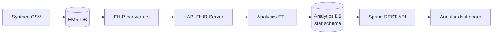

# EMR Bridge

A full-stack healthcare data pipeline that imports synthetic EMR data, converts it to **HL7 FHIR R4**, loads a star-schema analytics warehouse, and exposes clinical insights through an Angular dashboard.

This is a portfolio project that demonstrates healthcare interoperability (FHIR-based data exchange), multi-database backend design, and modern full-stack engineering, with a focus on scenarios relevant to hospital analytics.

> **Data disclaimer:** All patient records in this repository come from [Synthea](https://synthetichealth.github.io/synthea/) and are entirely synthetic. The repository contains **no real protected health information (PHI/PII)**.

---

## Overview

Healthcare systems rarely share a single schema. EMR Bridge models a realistic data path in four steps:

1. **Ingest** multi-table Synthea CSV files into a relational EMR database.
2. **Convert** clinical entities into **FHIR R4** resources and upload them to a HAPI FHIR server.
3. **Extract and load** Patient, Encounter, and Condition data into an analytics star schema.
4. **Visualize** dashboards, patient lists, condition analysis, and pipeline status in an Angular UI.

```text
Synthea CSV  →  EMR Postgres  →  HAPI FHIR (R4)  →  Analytics Postgres  →  Angular UI
                 (operational)     (interoperability)   (star schema)         (charts)
```

---

## Tech stack

| Layer | Technologies |
| --- | --- |
| Backend | Java 21, Spring Boot, Spring Data JPA, Spring Security (JWT), Spring Batch, Flyway, OpenCSV |
| FHIR | HAPI FHIR client, FHIR R4, HAPI FHIR server (Docker) |
| Databases | PostgreSQL × 3 (EMR, FHIR store, Analytics) |
| Frontend | Angular, Angular Material, ECharts |
| Infra | Docker Compose |

---

## Architecture



**Analytics model (star schema):** fact table for visits, with dimensions for patient, disease, region, time (and hospital where applicable).

**Backend modules:**

- `feature/emr` — CSV import into operational EMR tables  
- `feature/fhir` — domain → FHIR R4 conversion & upload  
- `feature/analytics` — FHIR extract → star schema ETL & query APIs  
- `feature/auth` — JWT login, role-based access (admin vs hospital-scoped users)

---

## Features

- Multi-database Flyway migrations (EMR + Analytics)  
- Re-runnable CSV import and batched FHIR uploads  
- Consistent patient identifiers across FHIR resources, so references between Patient, Encounter, and Condition resolve correctly  
- Analytics dashboard: demographics, regions, monthly visits, top conditions  
- Patient list / detail and condition analysis views  
- Pipeline status screen for EMR → FHIR → Analytics stages  

---

## Repository structure

```text
emrbridge/
├── backend/                 Spring Boot API & ETL
│   └── src/main/resources/
│       ├── csv/             Synthea sample data (synthetic)
│       └── db/migration/    Flyway scripts (emr / analytics)
├── frontend/                Angular SPA
├── docker-compose.yml       Postgres ×3 + HAPI FHIR + frontend image
└── README.md
```

---

## Quick start

### Prerequisites

- Docker & Docker Compose  
- Java 21  
- Node.js 22+ (see `frontend/.nvmrc`)

### 1. Start infrastructure

```bash
docker compose up -d emr-db fhir-db analytics-db hapi-fhir
```

| Service | Host port |
| --- | --- |
| EMR Postgres | `5432` |
| FHIR Postgres | `5433` |
| Analytics Postgres | `5434` |
| HAPI FHIR | `8081` |

Local DB credentials are **development defaults only** (see `docker-compose.yml` / `backend/src/main/resources/application.yml`). Do not reuse them outside local demos.

### 2. Run the backend

```bash
cd backend
./gradlew bootRun
```

API: `http://localhost:8080`  
OpenAPI UI (when enabled): `http://localhost:8080/swagger-ui.html`

### 3. Run the frontend

```bash
cd frontend
nvm use   # optional
npm install
npm start
```

UI: `http://localhost:4200` — `/api` is proxied to the backend.

### Typical demo flow

1. Import Synthea CSV into the EMR DB (`/api/emr/...`)  
2. Convert & upload to HAPI FHIR (`/api/fhir/...`)  
3. Run analytics ETL (`POST /api/analytics/etl/run`)  
4. Explore the Dashboard, Patients, Conditions, and Pipeline screens in the UI.

These endpoints are listed in the Swagger UI.

---

## Screens

| Route | Purpose |
| --- | --- |
| `/dashboard` | Clinical statistics overview |
| `/patients`, `/patients/:id` | Patient search and detail |
| `/conditions` | Condition / disease analysis |
| `/pipeline` | End-to-end processing status |
| `/login` | JWT sign-in |

---

## Security & Privacy Notes

- **Synthetic data only.** All patients, encounters, and conditions are generated by Synthea. Fake SSNs and demographics are part of the dataset by design.
- **Local credentials.** The Postgres passwords and the default JWT secret are for local development only. For any non-local use, override them through environment variables (for example, `APP_JWT_SECRET`).